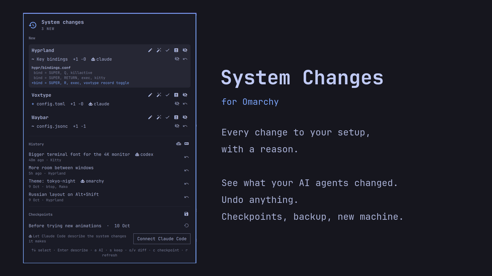

# syschange

[](https://github.com/dDan4a/syschange/actions/workflows/test.yml)

A history of changes to your Linux setup, with a reason for each one and undo.



You tweak a keybinding, install a package, enable a service. A week later something is off and you
don't remember what you touched, or your AI agent changed it while fixing something else.
syschange notices every change to your setup and asks for a one-line description. You can see the
diff and undo it.

- **Config files in `~/.config`**: kept in a private shadow git repository, so every edit has a diff
  and can be undone.
- **Packages** you installed explicitly (`pacman`, AUR included) and **systemd services** you enabled,
  system and user.
- **Human names**: "Hyprland: Key bindings" instead of `hypr/bindings.lua`.
- **Undo anything**: a change not recorded yet, or a recorded one later on. Undo takes back only that
  entry's lines, so later edits to the same file survive.
- **Checkpoints**: save the whole setup before an experiment, unrecorded edits included, and get back to it
  in one click. The state before a restore is saved too, so a restore can be undone.
- **Quiet on Omarchy**: an `omarchy update`, a theme or a font switch is recorded by itself as one entry
  ("Theme: tokyo-night"), not dumped on you as dozens of changed files.
- **Describe with AI**: one click (or `syschange suggest`) and your default agent reads the diff and
  proposes the line, in your system language. You edit or accept it.
- **You see which AI agent changed what**, even if it never says so. One click gives Claude Code, Codex,
  Gemini CLI and Grok a skill and hooks; an agent that changed your system records why before it finishes.
- **Backup to your own git repository**: `syschange remote set git@github.com:you/setup.git` and every change
  is pushed in the background. Dotfiles on autopilot, with a reason for each change.
- **New machine in one command**: `syschange apply git@github.com:you/setup.git` shows what it will do, then
  writes the config files, installs the packages (AUR too) and enables the services you added on the old one.
- **Markdown export**: the history with every change, what is not recorded yet, and the commands to repeat
  your setup on a new machine. One click in the panel, or keep a file (in Obsidian, your dotfiles…) updated
  after every change with `syschange export --auto FILE`.
- **Omarchy bar widget**: new changes, history, describe, diff, undo.

Browser and Electron profiles, caches, databases, binaries and anything that looks like a password,
token or key are never copied into the history.

## Install

On Omarchy, add the bar widget and press **Install syschange** in its panel:

```bash
omarchy plugin add https://github.com/dDan4a/syschange.git --enable --yes
```

The button opens a terminal, builds the CLI version the widget is written for into `~/.local/bin` and runs
`syschange init`. It uses your Go if you have one; otherwise mise (part of Omarchy) fetches Go just for this
build, without installing it globally. When the widget is updated and needs a newer CLI, the same button
offers the update.

By hand, anywhere:

```bash
GOBIN=~/.local/bin go install github.com/dDan4a/syschange@latest
syschange init
```

If `syschange` is somewhere off the shell's `PATH`, set the full path in the widget settings.

## Use

```text
$ syschange status
Hyprland  [hypr]
  ~ Key bindings  +1 -0
Packages  [packages]
  + voxtype

$ syschange note "Voice typing on Super+R" hypr voxtype
Recorded 2 change(s).
```

| Command | What it does |
|---|---|
| `syschange status [--json]` | changes not recorded yet |
| `syschange note [--by NAME] TEXT [ID...]` | record changes with a reason |
| `syschange skip [ID...]` | record changes without a reason |
| `syschange suggest [--agent NAME] [ID...]` | ask an AI agent for the description |
| `syschange diff [ID...]` | what changed in config files |
| `syschange revert ID...` | undo config changes; prints the `sudo` command for packages and services |
| `syschange ignore PATH` | never track this path |
| `syschange log [--grep TEXT]` | the history; with `--grep`, the entries whose description, files, packages or diff mention TEXT |
| `syschange undo ENTRY [PATH...]` | undo a recorded entry (commit from `log`, or its time), or only some of its files |
| `syschange checkpoint [NAME]` | save the whole setup now |
| `syschange checkpoints` | list checkpoints |
| `syschange restore NAME` | bring config files back to a checkpoint; prints the `sudo` commands for packages and services |
| `syschange remote [set URL\|off]` | back the history up to a private git repository |
| `syschange push` | push now; it also happens by itself after every change |
| `syschange apply [--yes] BACKUP` | bring a backed-up setup to this machine |
| `syschange digest [--days N]` | sum up the last N days: apps, packages, services, who changed them |
| `syschange notify [--remind-days N] [--no-digest]` | notifications due now, as JSON (the panel shows them) |
| `syschange export [--to FILE]` | Markdown: history and setup steps |
| `syschange export --auto FILE\|off` | keep FILE updated after every record |
| `syschange agents [install\|remove]` | connect Claude Code and Codex |

An ID is a file inside `~/.config` (`hypr/bindings.lua`), an app directory (`hypr`), a package or unit name,
or a group (`packages`, `services`). No ID means everything.

In the bar panel: `↑↓` select, `Enter` describe, `a` describe with AI, `s` keep without a description,
`o` (or a click on the app) shows the diff right in the panel, `v` opens it in a terminal, `c` checkpoint,
`m` export to Markdown and open it, `/` search the history, `r` refresh.
Each line can be undone or ignored; each history entry can be undone. Undo and "stop tracking an app"
ask for a second click.

## Omarchy

On Omarchy, `syschange init` adds `syschange.hook` to `~/.config/omarchy/hooks/{post-update,theme-set,font-set}.d/`.
When Omarchy updates itself or switches a theme or font, the hook records what that command changed
(files modified and packages installed since it started) as one entry by `omarchy`. Your own pending
changes are left alone. Run `syschange init` again to restore the hooks if you deleted them.

When an update changes a file you had edited yourself, its entry says so ("Changed your edits:
hypr/bindings.conf", and a `!` line in `syschange log`). **Keep mine** in the panel, or
`syschange undo ENTRY hypr/bindings.conf`, takes the update's change back out of that file only, with a
three-way merge: the rest of the update stays.

## Reminders and digest

When changes wait unrecorded for 3 days, the bar icon turns red and a notification says so, at most once
a day. Once a week a notification sums up the week before: which apps' configs changed, what was installed
or enabled, and by whom. Both are settings of the widget (**Remind after (days)**, 0 turns it off, and
**Weekly digest**). Without the bar, run `syschange notify` from a timer and show its JSON however you like;
`syschange digest` prints the summary any time.

## AI agents

### Describe with AI

`syschange suggest` runs Omarchy's default agent (`omarchy default agent`) once, without tools, on the diff of the
pending changes and prints one line. Supported: Claude Code (Haiku), Codex, Gemini CLI, Grok; pick
another with `--agent`. The diff goes to that agent's provider; files that look like secrets are never in it.

### Let agents record what they change

```bash
syschange agents install          # all installed agents; or name some: syschange agents install claude
```

| Agent | Skill | Hooks |
|---|---|---|
| Claude Code | `~/.claude/skills` | `SessionStart`, `PreToolUse`, `PostToolUse`, `Stop` in `~/.claude/settings.json` |
| Codex | `~/.codex/skills` | the same four in `~/.codex/hooks.json` |
| Gemini CLI | `~/.gemini/skills` | `SessionStart`, `BeforeTool`, `AfterTool`, `AfterAgent` in `~/.gemini/settings.json` |
| Grok | `~/.grok/skills` | the same four as Claude, in its own file `~/.grok/hooks/syschange.json` |

The **Connect** button in the panel names Omarchy's default agent (`omarchy default agent`) and connects it first;
the other installed agents are offered after it. Only agents whose config directory exists are touched. Edited files keep their key order, and the previous
version is saved as `*.syschange.bak`.

**Who changed what.** The tool hooks note when each tool call of an agent started and ended (a timestamp, nothing
else). A config file modified or a package installed inside such a window is marked with that agent, in the bar
and in the history, whether or not the agent describes it. The tool hooks only append a line to a file, so they
don't slow the agent down.

The stop hook asks the agent about the changes of **its own session** only, never about yours. It asks once per
turn, so an agent is never stuck in a loop. Records made by an agent carry its name in the history.
`syschange agents remove` undoes all of it.

Only want the skill? It also installs with [skills](https://github.com/vercel-labs/skills):
`npx skills add dDan4a/syschange`.

## Backup

`syschange remote set URL` takes any git URL: a private GitHub repo, a server, a path on a USB disk. The remote
gets the branch `config` (the history of `~/.config`), the branch `state` (the journal, package and service
lists, AUR packages, checkpoints) and the checkpoint refs. After every recorded change and every checkpoint,
a background push sends them; it never asks for a password, so use SSH keys or a credential helper. The cloud
icon in the panel shows the last push and turns red when it fails.

### On a new machine

```bash
syschange apply git@github.com:you/setup.git
```

`apply` reads the backup and compares it with this machine. It takes what you changed on top of the old
system since tracking started there: config files (added, changed, deleted), packages you installed (from the
repositories and the AUR) and services you enabled. It prints the plan and asks; nothing happens without a yes
(or `--yes`). Then it saves a checkpoint of the current state, writes the files, runs `sudo pacman -S --needed`,
`yay -S --needed` and `systemctl enable --now` in your terminal, and records everything as one entry. The config
part can be undone with `syschange restore "Before applying …"`. Packages removed on the old machine are listed,
never removed here. Running `apply` again only does what is still missing.

**Keep that repository private.** Files that look like secrets never enter the history, but the rest of your
config does.

## Where things live

| Path | What |
|---|---|
| `~/.local/state/syschange/config.git` | shadow repository of `~/.config` |
| `~/.local/state/syschange/config.git/info/exclude` | what is never tracked, gitignore syntax |
| `~/.local/state/syschange/journal.jsonl` | the history with descriptions |
| `~/.local/state/syschange/*.txt` | accepted package and service lists |

The state directory is `0700`. Nothing leaves your machine.

## Limits

- `/etc` is not tracked yet.
- Directories that are git repositories of their own (for example plugins cloned into `~/.config`) are
  not tracked file by file.
- Files over 256 KB are skipped.

## Remove

```bash
syschange agents remove                         # if you connected agents
omarchy plugin remove dan4a.syschange           # the bar widget
rm ~/.config/omarchy/hooks/*.d/syschange.hook   # the Omarchy hooks
rm -rf ~/.local/state/syschange                 # the history
rm "$(command -v syschange)"                    # the CLI
```

## License

MIT
